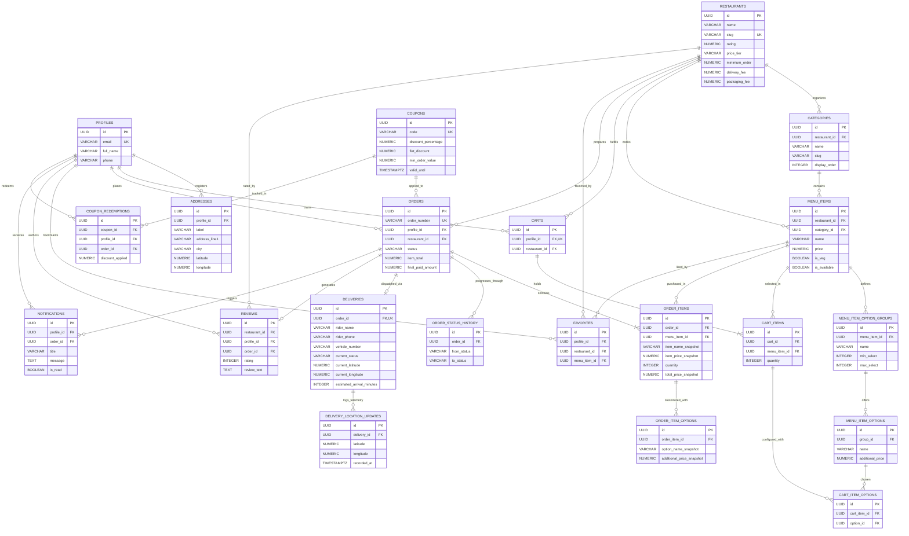

# ARO Entity-Relationship (ER) Specification

## 1. Master Relational Diagram (21 Entities)

---

## 2. Cardinality Matrix & Deletion Integrity

| Parent Entity | Dependent Entity | Cardinality | Delete Action | Rationale |
| :--- | :--- | :--- | :--- | :--- |
| `profiles` | `addresses` | 1 : N | `CASCADE` | User addresses belong strictly to customer account. |
| `profiles` | `orders` | 1 : N | `RESTRICT` | User accounts with order history cannot be deleted without audit preservation. |
| `restaurants` | `categories` | 1 : N | `CASCADE` | Categories are specific to restaurant menus. |
| `categories` | `menu_items` | 1 : N | `RESTRICT` | Active menu categories with dishes cannot be dropped abruptly. |
| `menu_items` | `option_groups` | 1 : N | `CASCADE` | Options are tied to dish configuration. |
| `carts` | `cart_items` | 1 : N | `CASCADE` | Cart flush cascades to item options. |
| `orders` | `order_items` | 1 : N | `CASCADE` | Canceling unconfirmed draft purges line items. |
| `order_items` | `order_item_options` | 1 : N | `CASCADE` | Line item customizations cascade with item. |
| `orders` | `deliveries` | 1 : 1 | `CASCADE` | Delivery assignment is uniquely bound to one order. |
| `deliveries` | `location_updates` | 1 : N | `CASCADE` | Rider telemetry history tied to delivery session. |
| `coupons` | `orders` | 1 : N | `SET NULL` | Expiring a coupon preserves historical order discount values. |
